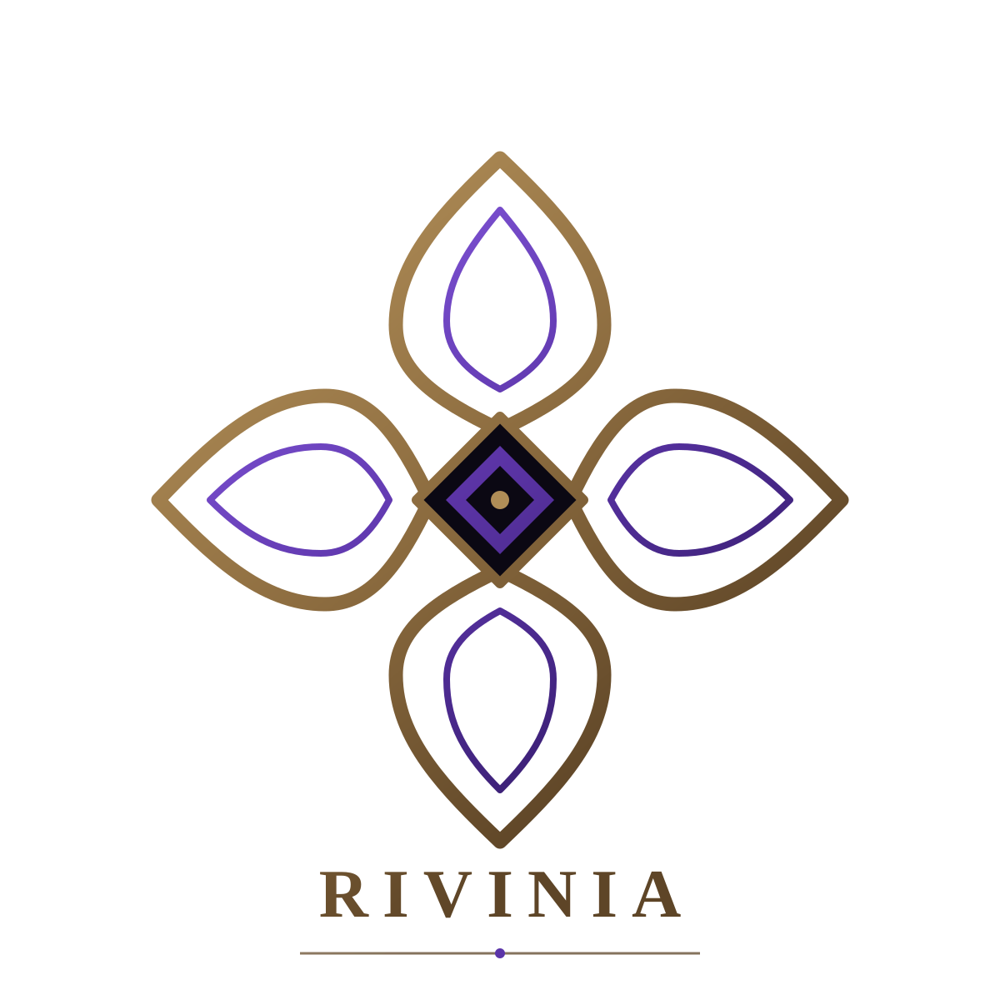

<p align="center">
  <picture>
    <source media="(prefers-color-scheme: dark)" srcset="./assets/rivinia-abstract-mark.svg" />
    <source media="(prefers-color-scheme: light)" srcset="./assets/rivinia-abstract-mark-light.svg" />
    
  </picture>
</p>

# Rivinia

Rivinia is a workspace of independently versioned Angular libraries for
application infrastructure and reusable UI behavior. Install and configure
only the package your application needs; each package README is the detailed
consumer reference for its public API.

Published packages target Angular 22. The npm versions below were checked on
2026-10-30. “Workspace” shows each package manifest's version and may be
unreleased. The authoritative version for a release is the package's published
npm metadata.

## Packages

| Package                                                  | Latest on npm                                              | Workspace | `ng add` | Use it for                                                                                      |
| -------------------------------------------------------- | ---------------------------------------------------------- | --------- | -------- | ----------------------------------------------------------------------------------------------- |
| [`@rivinia/http`](./projects/http/README.md)             | [0.5.3](https://www.npmjs.com/package/@rivinia/http)       | 0.5.4     | Yes      | Typed `HttpClient` methods, response-envelope unwrapping, and `httpResource` integration.       |
| [`@rivinia/toast`](./projects/toast/README.md)           | [0.5.1](https://www.npmjs.com/package/@rivinia/toast)      | 0.5.2     | Yes      | A headless signal-based notification queue with timers and actions.                             |
| [`@rivinia/modal`](./projects/modal/README.md)           | [0.6.1](https://www.npmjs.com/package/@rivinia/modal)      | 0.6.2     | Yes      | Headless modal coordination, stacking/queuing, and typed results.                               |
| [`@rivinia/i18n`](./projects/i18n/README.md)             | [0.8.0](https://www.npmjs.com/package/@rivinia/i18n)       | 0.8.0     | Yes      | Language state, direction, SSR-safe loaders, ICU plurals, and typed keys.                       |
| [`@rivinia/env`](./projects/env/README.md)               | [0.3.3](https://www.npmjs.com/package/@rivinia/env)        | 0.3.4     | Yes      | Typed application environment configuration (dev/staging/prod).                                 |
| [`@rivinia/menu`](./projects/menu/README.md)             | [0.4.0](https://www.npmjs.com/package/@rivinia/menu)       | 0.4.0     | No       | Headless menu behavior, keyboard navigation, and its optional ready-made UI.                    |
| [`@rivinia/select`](./projects/select/README.md)         | [0.7.0](https://www.npmjs.com/package/@rivinia/select)     | 0.7.0     | No       | Headless single/multi selection, search filtering, and optional UI at `@rivinia/select/ui`.     |
| [`@rivinia/theme`](./projects/theme/README.md)           | [0.1.0](https://www.npmjs.com/package/@rivinia/theme)      | 0.1.0     | No       | Shared design tokens for Rivinia component colors, shapes, and typography.                      |
| [`@rivinia/datepicker`](./projects/datepicker/README.md) | [0.1.0](https://www.npmjs.com/package/@rivinia/datepicker) | 0.1.0     | No       | Headless Gregorian date/time picker: month grid, time zones and DST, keyboard navigation, RTL.  |
| [`@rivinia/table`](./projects/table/README.md)           | [0.1.0](https://www.npmjs.com/package/@rivinia/table)      | 0.1.0     | No       | Headless table: typed columns, sorting, filtering, pagination, selection, and row/column spans. |

The `i18n-e2e` and `menu-e2e` projects are test harness applications that
serve the Playwright suites; they are not packages and are never published.
`pnpm check:docs` fails when a package is missing from this table or when the
version column drifts from its manifest.

## Install and configure

Install only the package(s) you plan to use. For example:

```bash
npm install @rivinia/http
ng add @rivinia/http
```

`ng add` applies that package's documented project setup. For packages without
an `ng add` schematic, follow the manual setup in that package's README.
Package-specific guides cover imports, providers, options, value types, and
common behavior.

## Work in this repository

This monorepo uses pnpm. From its root:

```bash
pnpm install
pnpm build:http
pnpm exec ng test http --watch=false
pnpm check:docs
```

Every package has a `build:<package>` script — for example `pnpm build:i18n`
or `pnpm build:table`. HTTP, toast, modal, i18n and environment builds also
compile their `ng add` schematics; `pnpm test:schematics` runs those suites.
Run a package's unit tests with
`pnpm exec ng test <project-name> --watch=false`, for example
`pnpm exec ng test select --watch=false`. The browser suites build first:
`npx ng build i18n && npx ng build i18n-e2e --configuration csr`, then
`npx playwright test --config projects/i18n-e2e/playwright.config.ts`.

## Release safety

Building a workspace package is not the same as publishing it. Do not publish
without confirming the package name, version, access, and inspected tarball;
follow the release gates in [`AGENTS.md`](./AGENTS.md) and the decisions in
[`docs/DECISIONS.md`](./docs/DECISIONS.md). Releases are tagged on `main` as
`<package>/v<semver>` (for example `i18n/v0.5.0`); tags are immutable.
