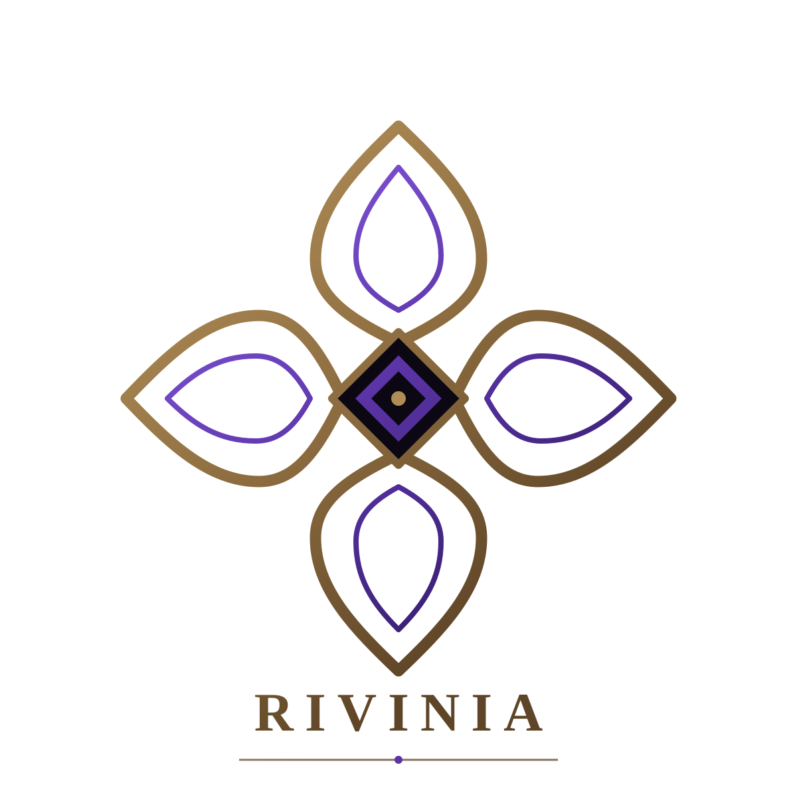

# @rivinia/theme

[](https://www.npmjs.com/package/@rivinia/theme)
[](https://www.npmjs.com/package/@rivinia/theme)

<p align="center">
  
</p>

The shared Rivinia design-token layer. One import, one place to set the whole
component ecosystem's colours, shapes and type.

- Package version: **0.1.0**
- Requires: **nothing** — it is a stylesheet, not code.
- Node: **same as Angular 22** (`^22.22.3 || ^24.15.0 || >=26.0.0`) — for the
  package manager's engine check only; the CSS has no runtime.
- Side effects: **the CSS itself** (`sideEffects: ["**/*.css", "**/*.scss"]`).

## Quick features

- **One import.** `@import '@rivinia/theme';` — the same shape as
  `@import 'tailwindcss';`.
- **Every component follows.** Select, menu, modal and toast all read the same
  semantic tokens, so a palette change reaches all of them at once.
- **Per-component override still wins.** The chain is
  `--rv-select-bg → --rv-bg → #ffffff`: narrowest first, then the global
  layer, then the built-in default.
- **Framework-neutral.** Plain CSS, Tailwind v4, Bootstrap 5.3, Sass and Less
  all work, because the components read CSS custom properties and every one of
  those stacks can produce or consume them.
- **Light and dark out of the box.** The OS preference is honoured, a
  `data-rv-theme` attribute overrides it either way, and `color-scheme` follows
  so form controls and scrollbars match.
- **Your rules always win.** The defaults live inside `@layer rivinia-theme`,
  and unlayered declarations beat layered ones — so your `:root` mapping wins
  wherever it appears, with no import-ordering to get wrong.

## Install

```bash
npm install @rivinia/theme
```

or

```bash
pnpm add @rivinia/theme
```

or

```bash
yarn add @rivinia/theme
```

or

```bash
bun add @rivinia/theme
```

## Quick start

```css
/* your stylesheet */
@import '@rivinia/theme';

:root {
  /* your palette — the whole ecosystem follows */
  --rv-bg: #ffffff;
  --rv-fg: #111111;
  --rv-border: #e0e0e0;
}

[data-rv-theme='dark'] {
  --rv-bg: #161616;
  --rv-fg: #f2f2f2;
  --rv-border: #3f3f46;
}
```

## The tokens

Every colour ships in two schemes.

| Token          | Paints             | Light                         | Dark                         |
| -------------- | ------------------ | ----------------------------- | ---------------------------- |
| `--rv-bg`      | surface background | `#ffffff`                     | `#161616`                    |
| `--rv-fg`      | text               | `#111111`                     | `#f2f2f2`                    |
| `--rv-muted`   | secondary text     | `#555555`                     | `#a1a1aa`                    |
| `--rv-border`  | borders            | `#e0e0e0`                     | `#3f3f46`                    |
| `--rv-radius`  | corner radius      | `10px`                        | same                         |
| `--rv-shadow`  | elevation          | `0 16px 48px rgba(0,0,0,.22)` | `0 16px 48px rgba(0,0,0,.6)` |
| `--rv-font`    | font stack         | system stack                  | same                         |
| `--rv-accent`  | brand / primary    | `#5b5bd6`                     | `#8b8bf0`                    |
| `--rv-danger`  | destructive        | `#dc2626`                     | `#f87171`                    |
| `--rv-ok`      | success            | `#16a34a`                     | `#4ade80`                    |
| `--rv-info`    | informational      | `#2563eb`                     | `#60a5fa`                    |
| `--rv-warning` | caution            | `#d97706`                     | `#fbbf24`                    |

These twelve names are the public contract: they are what every Rivinia
component reads, and what you are meant to set. Renaming one is a breaking
change; adding one is not.

Each package also owns tokens of its own — `--rv-select-bg`,
`--rv-menu-bg`, `--rv-modal-bg`, `--rv-toast-bg` — and they resolve as:

```
--rv-select-bg  →  --rv-bg  →  #ffffff
```

So there are three levels of control, and each beats the next:

| Level          | Token            | Scope                               |
| -------------- | ---------------- | ----------------------------------- |
| 1. per package | `--rv-select-bg` | that component only                 |
| 2. global      | `--rv-bg`        | every Rivinia component, everywhere |
| 3. default     | —                | what you get if you set nothing     |

**Map the global palette on `:root`.** An element-level declaration shadows the
root value for that element's subtree, so `--rv-bg` set inside a component
stylesheet changes that component only and stops any page-level override from
reaching it. Set `--rv-*` on a subtree only when that scoped override is what
you mean.

## Dark mode

The dark values apply from **two** places, and they are kept identical:

```css
/* 1. the OS setting, unless the page opts out */
@media (prefers-color-scheme: dark) {
  :root:not([data-rv-theme='light']) {
    --rv-bg: #161616; /* … */
  }
}

/* 2. an explicit switch that beats a light OS setting */
:root[data-rv-theme='dark'] {
  --rv-bg: #161616; /* … */
}
```

| You want                 | Do this                                |
| ------------------------ | -------------------------------------- |
| Follow the OS            | nothing                                |
| Always light             | `<html data-rv-theme="light">`         |
| Always dark              | `<html data-rv-theme="dark">`          |
| A dark section in a page | `data-rv-theme="dark"` on that subtree |

Both blocks also set `color-scheme`, so form controls, scrollbars and the
canvas follow the palette instead of staying light under a dark surface. If you
override the dark values yourself, set `color-scheme: dark` in the same rule.

**Adapters.** The Tailwind adapter needs nothing: its utilities are `inline`
aliases of `--rv-*`, so they follow the switch. The Bootstrap adapter maps both
schemes from `--bs-*` and sets `color-scheme` itself — its rules are unlayered
so that Bootstrap stays authoritative even when the OS preference says dark.

`pnpm check:theme-dark` proves all of this in Chromium and Firefox: seven cases
across both engines, reading the computed background, colour and `color-scheme`
from real pages.

## Contrast

The two palettes are checked, not assumed. `pnpm check:contrast` measures every
documented pair in both schemes and fails the build when one drops below its
threshold:

| Group      | Pairs                                                              | Threshold |
| ---------- | ------------------------------------------------------------------ | --------- |
| text       | `--rv-fg`, `--rv-muted`, `--rv-accent` on `--rv-bg`                | 4.5:1     |
| indicator  | `--rv-danger`, `--rv-ok`, `--rv-info`, `--rv-warning` on `--rv-bg` | 3:1       |
| decorative | `--rv-border` on `--rv-bg`                                         | reported  |

Measured today: text is 18.88, 7.46 and 5.37 in light and 16.16, 7.06 and 6.07
in dark; the indicators are 3.19 to 5.17 in light and 6.54 to 10.84 in dark.

Two limits worth knowing:

- `--rv-border` is a hairline around surfaces, not the only boundary of a
  control, and it measures 1.32:1 on white (1.73:1 on `#161616`). It is printed
  by the check but never fails it. If you rely on the border alone to identify
  a control, raise it yourself — WCAG 1.4.11 wants 3:1.
- The status tokens are guaranteed as **indicators**. On white, `--rv-ok` and
  `--rv-warning` are 3.30 and 3.19 — enough for a border or a dot, not for text.
  Use `--rv-fg` or `--rv-muted` for words.

The Bootstrap and Tailwind adapters replace these values with your stack's, so
the guarantee covers the palette this package ships, not the colours your
framework supplies.

## Overrides

The theme is a **global stylesheet import**: your components never import it,
they read `var(--rv-*)`, and the value comes from wherever the theme is mapped
in the page.

Four placements look right. Three silently do nothing, and the fourth works
with a cost:

| Placement                                        | Result                                                                                                               |
| ------------------------------------------------ | -------------------------------------------------------------------------------------------------------------------- |
| `@layer base { :root { --rv-bg: … } }`           | loses — `rivinia-theme` is declared after `base`, and between layers the later one wins                              |
| `@theme { --rv-bg: … }` (Tailwind)               | ignored — `--rv-bg` is not a Tailwind theme key                                                                      |
| `:root { --rv-bg: … }` in a component stylesheet | never applies — Angular rewrites `:root` to `[_ngcontent-…]:root`, which matches nothing                             |
| `@theme { --color-rv-bg: … }` (Tailwind)         | works — but `@theme` emits at `:root`, it replaces the alias, and a subtree `--rv-bg` then stops reaching `bg-rv-bg` |

Put the override in a **global** stylesheet, **unlayered**, on `:root` or on a
subtree selector. Unlayered declarations beat layered ones, so its position in
the file does not matter.

The bare `@import '@rivinia/theme';` is resolved by a **bundler** through the
package's `style` export condition (measured with Angular CLI; other bundlers
not measured). A page loading CSS with no bundler has to name the file:
`@import '@rivinia/theme/theme.css';`.

## Which styling stack?

| Stack           | How you wire it                                                                      |
| --------------- | ------------------------------------------------------------------------------------ |
| **Plain CSS**   | `@import '@rivinia/theme';` then set `--rv-*` on `:root`.                            |
| **Tailwind v4** | `@import '@rivinia/theme/tailwind.css';` — utilities `bg-rv-*`; colour via `--rv-*`. |
| **Bootstrap**   | `@import '@rivinia/theme/bootstrap.css';` — your `--bs-*` become `--rv-*`.           |
| **Sass / SCSS** | `@use '@rivinia/theme/scss';` — bundlers only; the `sass` CLI needs `pkg:`.          |
| **Less**        | `@import (less) '@rivinia/theme/theme.css';` — the explicit file, nothing else.      |

Import the Tailwind or Bootstrap adapter **instead of** the base entry, never in
addition: the adapter already imports the base, and both together emit the
theme twice (1,019 B of built CSS instead of 613 B).

### Tailwind v4

```css
@import 'tailwindcss';
@import '@rivinia/theme/tailwind.css';

:root {
  --rv-bg: #ffffff;
  --rv-fg: #111111;
}
```

The adapter registers `--color-rv-bg`, `--color-rv-fg`, `--color-rv-accent`, …
with `@theme inline`, so `bg-rv-bg`, `text-rv-accent`, `border-rv-border` and
the rest are generated, and each utility reads the semantic token on the
element. A subtree override therefore paints that subtree:

```css
/* bg-rv-bg inside .promo paints #101828 */
.promo {
  --rv-bg: #101828;
}
```

Both adapter blocks are `inline` because they reference other variables, and
`inline` is what makes the reference resolve at use-site.

**Set colours with `--rv-*`, not `--color-rv-*`.** `--color-rv-*` is the name
Tailwind generates a utility from. Overriding it on an element no longer reaches
the utility — before 0.2.0, with a plain `@theme` block, it did. A later
`@theme { --color-rv-bg: … }` still wins, but it replaces the alias, so that
token stops following `--rv-bg` in the same stylesheet.

### Bootstrap 5.3

```css
@import 'bootstrap/dist/css/bootstrap.css';
@import '@rivinia/theme/bootstrap.css';
```

The adapter maps the semantic layer onto `--bs-body-bg`, `--bs-body-color`,
`--bs-border-color` and `--bs-secondary-color`, under both
`[data-bs-theme='light']` and `[data-bs-theme='dark']`. A Bootstrap theme
switch re-themes the Rivinia components with no extra wiring.

Import order does not matter — the adapter and Bootstrap read each other through
`var()`, which resolves at computed-value time (measured: swapping the two lines
gives identical colours). The order above is the readable one.

### Sass

```scss
@use '@rivinia/theme/scss';
```

`@rivinia/theme/scss` is a one-line SCSS file that forwards the stylesheet, so
`@use` has a stable module specifier. The extension is optional in both
spellings — `@use '@rivinia/theme/theme.css'` compiles to the same CSS.

Bundlers that compile your stylesheet (measured with Angular CLI; Vite not
measured) resolve that specifier through the package's `exports`. The **`sass`
CLI** does not read `exports`, so give it the `pkg:` scheme:

```bash
sass --pkg-importer=node styles.scss
```

```scss
@use 'pkg:@rivinia/theme/scss';
```

`--pkg-importer=node` requires Dart Sass 1.71+.

### Less

```less
@import (less) '@rivinia/theme/theme.css';
```

The explicit file is the only spelling that works in Less 4. Less resolves bare
specifiers from `node_modules` but ignores `exports`, so:

- `@import (less) '@rivinia/theme';` compiles to **nothing** — Less inlines the
  package root, which is the empty ESM entry, and the theme silently disappears;
- `@import (less) '@rivinia/theme/scss';` is invalid in Less (that file is Sass).

Less passes CSS custom properties through untouched. Less **variables**
(`@color: …`) are a different mechanism and do not interoperate with them — use
`var(--rv-*)` inside Less files.

## Conditionals

The stylesheet uses `@supports` and `@media` only — no Sass or Less syntax —
so it compiles as plain CSS anywhere. Your own `@if` / `@media` rules live in
your files and can override anything the tokens expose.

## For contributors

- `pnpm build:theme` — production build into `dist/theme`.
- `pnpm test:theme` — the packaging-check tests, run against synthetic packages
  in temp dirs (no build needed).
- `pnpm check:theme` — asserts the packaged contract of `dist/theme` after a
  build: `exports["."].style` exists and resolves, every other export target
  exists, the file list is exactly the expected nine, and `styles/theme.css`
  declares `--rv-bg` inside `@layer rivinia-theme`. Pass a path to check
  something else — before a release, the tarball:
  `pnpm check:theme rivinia-theme-x.y.z.tgz`.
- `pnpm check:contrast` — reads `styles/theme.css`, proves the two dark blocks
  agree and the light block carries the palette, then measures every documented
  pair in both schemes against WCAG AA.
- `pnpm check:theme-dark` — renders seven documents in Chromium and Firefox to
  prove the cascade: OS preference, `data-rv-theme` opt-out and override, and
  both Bootstrap directions. Needs the Playwright browsers installed.

## License

MIT.
